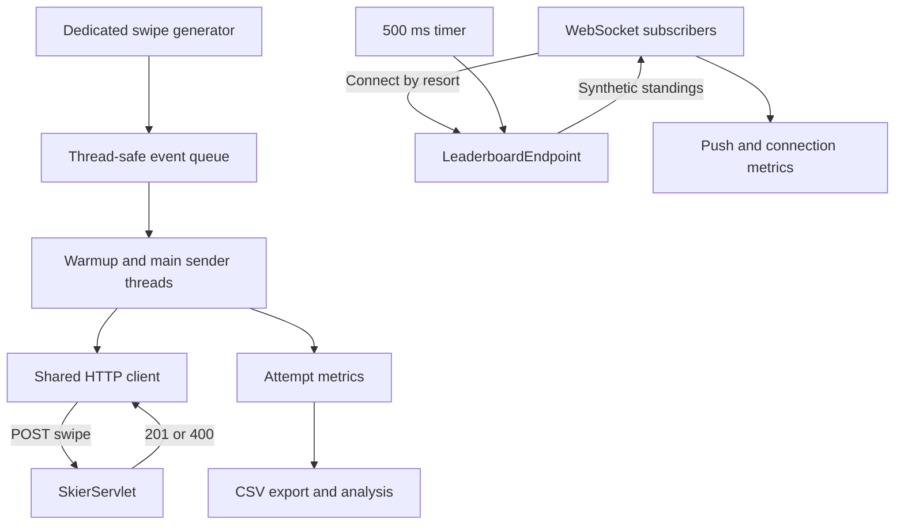
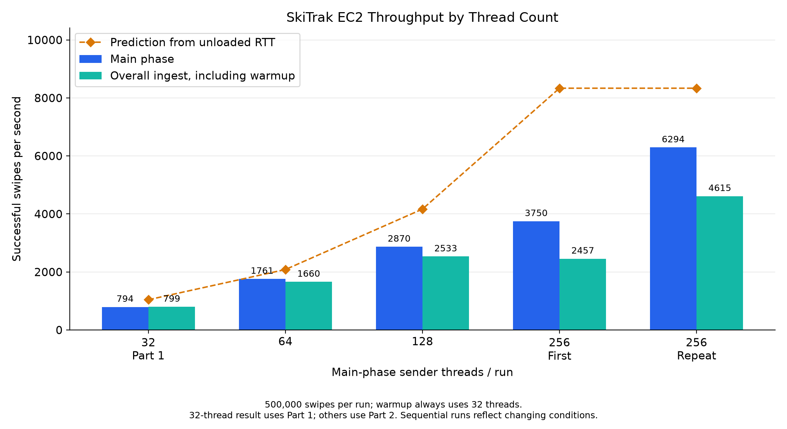
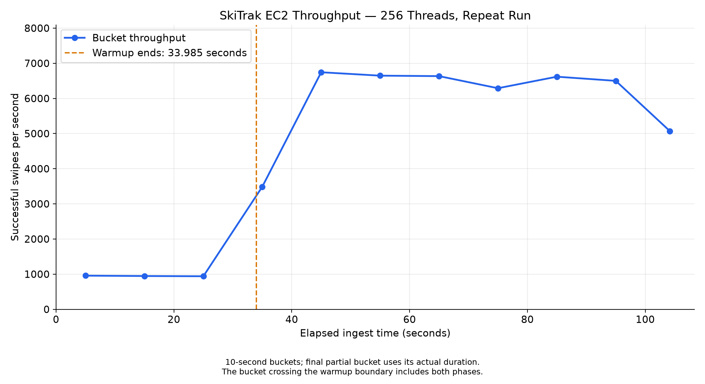

# SkiTrak

A distributed systems project for ski-resort swipe ingestion and live leaderboard delivery, developed for **CS6650**.

The project evolves across assignments. Assignment 1 implements a lightweight Java server and a multithreaded client that sends **500,000 lift-ride events** while maintaining persistent WebSocket leaderboard subscriptions.

## Assignment 1 Scope

The server validates and acknowledges swipe events. It does not persist events or calculate skier standings.

The leaderboard is synthetic: the server pushes canned standings every **500 milliseconds**, independently of incoming swipes.

The main engineering focus is client concurrency, HTTP connection reuse, WebSocket connection management, and performance measurement.

## Technology Stack

| Component | Technology |
|---|---|
| Server | Java 11-compatible source, Servlet API, Gson |
| Deployment | Single WAR on Apache Tomcat 9 |
| HTTP load client | Java `HttpClient`, HTTP/1.1 |
| WebSocket client | Java `WebSocket` API |
| Concurrency | Dedicated generator thread, sender threads, thread-safe queue |
| Metrics | Java timing APIs, CSV export |
| Charts | Python and Matplotlib |
| Cloud environment | AWS EC2, Amazon Linux 2023, `us-west-2` |

Tomcat 9 uses the `javax.servlet` and `javax.websocket` namespaces.

## Repository Layout

| Directory | Contents |
|---|---|
| `server/` | Swipe servlet, health servlet, and synthetic leaderboard endpoint |
| `client-part1/` | Load client with basic metrics and single-request latency measurement |
| `client-part2/` | Load client with detailed HTTP latency measurements and CSV export |
| `results/` | Run logs, CSV measurements, charts, plotting scripts, and TCP diagnostic summaries |

Generated build files, local Python environments, credentials, and packet captures are excluded from Git.

## Architecture

The client operates two independent communication paths:

- **REST ingest:** sender threads share one HTTP client and POST lift-ride events to Tomcat.
- **WebSocket subscriptions:** one subscriber per configured resort receives periodic leaderboard updates and reconnects after a connection drop.

Both server endpoints run in the same WAR and Tomcat instance.



### Server Classes

| Class | Responsibility |
|---|---|
| `SkierServlet` | Validate swipe paths and request bodies; acknowledge valid swipes |
| `HealthServlet` | Return a simple server health response |
| `LeaderboardEndpoint` | Manage resort subscriptions and push synthetic standings |
| `LiftRide` | Represent the swipe request body |
| `ResponseMsg` | Represent JSON response messages |

### Client Classes

| Class | Responsibility |
|---|---|
| `SwipeEvent` | Store event fields and construct the request path and JSON body |
| `SwipeGenerator` | Generate the configured event set on a dedicated thread |
| `SwipeSender` | Send synchronous POST requests and retry failed attempts |
| `LeaderboardSubscriber` | Receive leaderboard messages, record metrics, and reconnect |
| `LoadClient` | Coordinate generation, subscriptions, warmup, main phase, and reporting |
| `SingleRequestLatency` | Measure baseline request latency and calculate throughput estimates |
| `PerformanceMetrics` | Collect detailed attempt records and export CSV data in Part 2 |

## Prerequisites

- JDK 11 or later
- Maven
- Apache Tomcat 9
- Python 3 and Matplotlib for chart generation
- Postman with WebSocket support, or another WebSocket testing client
- An EC2 instance and SSH access for cloud deployment

Check the local tools:

```bash
java -version
mvn -version
python3 --version
```

## Build and Run the Server

Run commands from the repository root unless indicated otherwise.

### 1. Build the WAR

```bash
cd server
mvn clean package
```

The current Maven configuration creates:

```text
output/ski-servlet-1.0-SNAPSHOT.war
```

### 2. Deploy to Tomcat 9

Set `TOMCAT_DIR` to your actual installation directory:

```bash
TOMCAT_DIR="/path/to/apache-tomcat-9"
```

Copy the WAR:

```bash
cp output/ski-servlet-1.0-SNAPSHOT.war \
  "$TOMCAT_DIR/webapps/ski-servlet.war"
```

Start Tomcat if it is not already running:

```bash
bash "$TOMCAT_DIR/bin/catalina.sh" run
```

This runs Tomcat in the foreground. Keep the terminal open.

The WAR filename establishes the application context:

```text
http://localhost:8080/ski-servlet
```

## Server Endpoints

### Health

```http
GET /ski-servlet/health
```

Test:

```bash
curl -i http://localhost:8080/ski-servlet/health
```

Expected: **HTTP 200**

```json
{"status":"UP"}
```

### Swipe Ingest

```http
POST /ski-servlet/skiers/{resortID}/seasons/{seasonID}/days/{dayID}/skiers/{skierID}
```

Request body:

```json
{
  "time": 217,
  "liftID": 21
}
```

Validation rules:

| Field | Valid values |
|---|---|
| `resortID` | Positive integer |
| `seasonID` | Positive integer |
| `dayID` | Positive integer |
| `skierID` | Positive integer |
| `time` | 1–360 |
| `liftID` | 1–40 |

Valid requests return **HTTP 201**. Invalid paths or request bodies return **HTTP 400**.

Test a valid request:

```bash
curl -i -X POST \
  http://localhost:8080/ski-servlet/skiers/1/seasons/2026/days/1/skiers/123 \
  -H "Content-Type: application/json" \
  -d '{"time":217,"liftID":21}'
```

Expected response:

```json
{"message":"Lift ride accepted"}
```

Test an invalid lift ID:

```bash
curl -i -X POST \
  http://localhost:8080/ski-servlet/skiers/1/seasons/2026/days/1/skiers/123 \
  -H "Content-Type: application/json" \
  -d '{"time":217,"liftID":41}'
```

Expected: **HTTP 400**

### Synthetic Leaderboard

```text
ws://localhost:8080/ski-servlet/leaderboard/{resortID}
```

For resort 1, connect using Postman's WebSocket request:

```text
ws://localhost:8080/ski-servlet/leaderboard/1
```

No subscription message is required after connecting. The resort is selected by the URL.

Messages contain:

```json
{
  "resortID": "1",
  "serverTimestamp": "2026-01-20T18:03:12.481Z",
  "top": [
    {"rank": 1, "skierID": 40213, "vertical": 44120},
    {"rank": 2, "skierID": 11872, "vertical": 43880}
  ]
}
```

The deployed endpoint currently includes five synthetic leaderboard entries.

## Load Generation and Threading

Each load run generates **500,000 logical swipe events**.

| Field | Generation rule |
|---|---|
| `skierID` | Random integer from 1 to 100,000 |
| `resortID` | Random integer from 1 to the configured resort count |
| `liftID` | Random integer from 1 to 40 |
| `seasonID` | Fixed for the run |
| `dayID` | Fixed for the run |
| `time` | Random integer from 1 to 360 |

### Generation

One dedicated thread generates all events into an `ArrayBlockingQueue` with capacity for the full run.

The coordinator waits for generation to complete before starting sender threads. Consequently, senders never wait for event generation. Generation time is reported separately and included in setup-inclusive runtime.

This approach trades additional memory for predictable event availability.

### Warmup

- Exactly **32 sender threads**
- Exactly **1,000 logical swipes per thread**
- **32,000 logical swipes** in total
- Warmup runtime and throughput reported separately

### Main Phase

After every warmup thread terminates, a new sender group sends the remaining **468,000 logical swipes**.

The main thread count is configurable. Events are distributed across workers as evenly as possible.

### HTTP Requests and Retries

All sender threads share one `HttpClient`, which manages HTTP/1.1 connection reuse internally.

A swipe succeeds only when the response status is **201**.

A failed send receives up to **five retries**, following the initial attempt. Retry delays are:

```text
100 ms → 200 ms → 400 ms → 800 ms → 1,600 ms
```

Logical swipe counts and HTTP attempt counts are reported separately. A retried swipe can therefore produce more than one HTTP attempt.

### WebSocket Subscriptions

One persistent subscriber is opened per configured resort before ingest begins.

Subscribers remain active during warmup and the main phase. Connection drops trigger a reconnect attempt after one second.

The client handles fragmented text messages and records:

- Updates received per subscriber
- Successful connection establishments
- Reconnection count
- Failed connection attempts
- Connection establishment duration
- Timestamp-based push latency

## Run Client Part 1

From the repository root:

```bash
cd client-part1
mvn compile
```

Run locally:

```bash
java -cp target/classes LoadClient \
  http://localhost:8080/ski-servlet 32
```

### Command-Line Arguments

```text
LoadClient [baseUrl] [mainThreads] [resortCount] [seasonID] [dayID]
```

| Argument | Default |
|---|---|
| `baseUrl` | `http://localhost:8080/ski-servlet` |
| `mainThreads` | `32` |
| `resortCount` | `10` |
| `seasonID` | `2026` |
| `dayID` | `1` |

Example with every argument:

```bash
java -cp target/classes LoadClient \
  http://localhost:8080/ski-servlet 256 10 2026 1
```

### Baseline Latency Measurement

```bash
java -cp target/classes SingleRequestLatency \
  http://localhost:8080/ski-servlet
```

The measurement includes:

1. The first request, including initial connection setup
2. Twenty unreported requests to warm the connection
3. One hundred measured sequential requests using connection reuse

This baseline test is separate from the load client's 32,000-swipe warmup.

## Run Client Part 2

From the repository root:

```bash
cd client-part2
mvn compile
```

Run:

```bash
java -cp target/classes LoadClient \
  http://localhost:8080/ski-servlet 256
```

Part 2 accepts the same arguments as Part 1 and adds detailed HTTP measurements.

### Reported Statistics

- Successful and failed logical swipes
- HTTP attempts, retries, non-201 responses, and I/O errors
- Generation, warmup, main-phase, and ingest durations
- Main-phase and overall throughput
- HTTP latency: mean, median, p95, p99, min, and max
- Successful throughput per resort
- WebSocket updates, connection statistics, and push-latency percentiles

Percentiles use the nearest-rank method.

### CSV Output

When launched from `client-part2`, each run creates:

```text
results/part2-<threads>threads-<runTimestamp>/
```

#### `swipes.csv`

```text
timestamp,requestType,latency,statusCode,resortID,responseTimestamp
```

- Timestamps are epoch milliseconds.
- Latency is measured in milliseconds using `System.nanoTime()`.
- Each row represents one HTTP attempt, including retries.
- Retry backoff is excluded from attempt latency.
- Status code `0` means the attempt ended without a received HTTP response.
- `responseTimestamp` is the attempt-end timestamp, including attempts without a response.

#### `throughput.csv`

```text
bucketStartSeconds,bucketEndSeconds,successfulSwipes,throughput
```

Throughput is calculated from successful response completion times in **10-second buckets**.

The final partial bucket uses its actual duration. Warmup is included; a bucket crossing the warmup boundary includes both phases.

Measurements are retained in memory during ingest. CSV export occurs afterward and is excluded from the reported ingest runtime.

## EC2 Deployment

The tested server runs on Amazon Linux 2023 in `us-west-2`, using Tomcat 9 and Amazon Corretto 11.

### Network Access

Allow inbound:

| Port | Purpose |
|---|---|
| 22 | SSH |
| 8080 | HTTP and WebSocket traffic |

For a client running on your laptop, set the security-group source to your current public IP.

### Upload the WAR

Build the server locally, then run from `server`:

```bash
scp -i /path/to/key.pem \
  output/ski-servlet-1.0-SNAPSHOT.war \
  ec2-user@EC2_PUBLIC_IP:~/ski-servlet.war
```

### Deploy on the Tested EC2 Installation

Connect:

```bash
ssh -i /path/to/key.pem ec2-user@EC2_PUBLIC_IP
```

On EC2:

```bash
sudo cp ~/ski-servlet.war \
  /opt/tomcat9/webapps/ski-servlet.war
```

If Tomcat is stopped:

```bash
sudo bash /opt/tomcat9/bin/startup.sh
```

Inspect logs:

```bash
sudo tail -n 80 /opt/tomcat9/logs/catalina.out
```

Test on EC2:

```bash
curl -i http://localhost:8080/ski-servlet/health
```

Then test from your laptop:

```bash
curl -i --max-time 10 \
  http://EC2_PUBLIC_IP:8080/ski-servlet/health
```

Replace `EC2_PUBLIC_IP` with the current address from the EC2 console. The public IP may change after a stop/start.

The current deployment uses Tomcat's startup script. After an instance restart, verify Tomcat is running before testing.

### Run a Cloud Load Test

From `client-part2` on your laptop:

```bash
java -cp target/classes LoadClient \
  http://EC2_PUBLIC_IP:8080/ski-servlet 256 \
  | tee ../results/part2-ec2-run.txt
```

## Little's Law Analysis

For synchronous senders with approximately one outstanding request per thread:

```text
Predicted throughput ≈ sender count / mean response time in seconds
```

The measured EC2 baseline reused-connection RTT was **30.713 ms**. Estimates below use the program's unrounded measurement.

| Sender threads | Predicted swipes/sec |
|---:|---:|
| 32 | 1,041.90 |
| 64 | 2,083.80 |
| 128 | 4,167.60 |
| 256 | 8,335.19 |

These predictions assume response time remains constant as concurrency increases. They do not account fully for scheduling, server queuing, network variation, retries, or client processing.

Connection establishment is measured separately because the baseline assumes connection reuse.

## Observed EC2 Results

Every run below completed with **500,000 successful logical swipes** and **zero permanently failed swipes**.

| Client / main threads | Warmup sec | Main sec | Main swipes/sec | Overall ingest swipes/sec | Retries |
|---|---:|---:|---:|---:|---:|
| Part 1 / 32 | 36.212 | 589.192 | 794.31 | 799.48 | 0 |
| Part 2 / 64 | 35.466 | 265.736 | 1,761.15 | 1,660.00 | 0 |
| Part 2 / 128 | 34.294 | 163.093 | 2,869.54 | 2,533.06 | 6 |
| Part 2 / 256, first | 78.725 | 124.811 | 3,749.67 | 2,456.54 | 1 |
| Part 2 / 256, repeat | 33.985 | 74.359 | 6,293.81 | 4,614.83 | 1 |
| Part 2 / 256, capture run | 37.111 | 86.543 | 5,407.69 | 4,043.45 | 29 |

**256 threads produced the fastest observed main phase**, reaching approximately **75.5%** of its unloaded baseline prediction in the repeat run.

The results do not establish a universal optimum:

- Runs occurred sequentially under changing conditions.
- The 32-thread EC2 result used Part 1; the other configurations used Part 2.
- Part 2 adds measurement overhead.
- The two initial 256-thread runs showed substantial variability.
- The packet-capture run occurred in a later session with capture enabled.

### HTTP Latency: Fastest Observed Run

For the 256-thread repeat, across warmup and main-phase attempts:

| Statistic | Milliseconds |
|---|---:|
| Mean | 39.315 |
| Median | 35.819 |
| p95 | 61.047 |
| p99 | 93.503 |
| Min | 11.995 |
| Max | 2,319.944 |

## Charts

### EC2 Thread Comparison



This chart includes the initial 32-, 64-, and 128-thread runs and both initial 256-thread runs. It excludes the later packet-capture run.

### 256-Thread Throughput Over Time



The vertical marker identifies the end of the fixed 32-thread warmup.

## Generate Charts

From the repository root:

```bash
python3 -m venv .venv
source .venv/bin/activate
python -m pip install matplotlib
```

Generate the comparison and 256-thread charts:

```bash
python results/plot_comparision.py
```

The script filename currently contains `comparision`.

Generate a chart from a particular run's CSV:

```bash
python results/plot_throughput.py \
  results/part2-256threads-1791755317589/throughput.csv
```

The comparison script contains the recorded run summaries and a specific 256-thread CSV path. Update those inputs when adding new runs. Check the single-run script's title matches the environment and thread count being plotted.

## TCP Connection Diagnostics

A separate 256-thread run was captured with `tcpdump`, filtered to the EC2 server's TCP port 8080.

| Observation | Count |
|---|---:|
| Captured packets | 2,553,645 |
| Packets dropped by kernel | 0 |
| Outgoing SYN packets | 5,724 |
| Distinct TCP opening attempts | 5,076 |
| Repeated SYN packets | 648 |
| Opening attempts with observed SYN-ACK | 5,076 |
| Opening attempts without observed SYN-ACK | 0 |
| Application-level HTTP retries | 29 |
| Successful WebSocket connections | 10 |
| WebSocket reconnections | 0 |

Distinct opening attempts were identified by source endpoint, destination endpoint, and initial sequence number.

These are transport-level observations:

- The capture includes HTTP and WebSocket traffic.
- SYN-ACK matching confirms server responses, not completed handshakes.
- Repeated SYNs are not application reconnections.
- HTTP retries are not equivalent to new TCP connections.
- Physical HTTP connection and replacement counts are not exposed by the current Java client.
- This capture analysis does not attribute each opening attempt to a protocol or determine why a new connection was opened.

Supporting summaries are stored in `results/tcp-connection-summary.txt`. The raw packet capture is retained locally and excluded from Git.

## Push-Latency Limitation

The client calculates:

```text
push latency = client receipt timestamp − server send timestamp
```

The timestamps come from different machines and include clock skew.

EC2 runs produced negative values, demonstrating that the clocks were not sufficiently aligned for accurate absolute one-way latency measurement. The signed values are preserved in the logs; they must not be interpreted as negative network delivery times.

Automatic time synchronization can reduce skew but does not guarantee accurate one-way latency.

## Troubleshooting

| Symptom | Check |
|---|---|
| Local connection refused | Start Tomcat and confirm it listens on port 8080 |
| EC2 request times out | Check instance state, current public IP, and port 8080 security-group rule |
| SSH times out | Check current public IP and the port 22 rule |
| HTTP 404 | Confirm WAR deployment, application context, and startup logs |
| WebSocket connection fails | Confirm the `/leaderboard/{resortID}` URL and use `ws://` for HTTP deployment |
| Python package installation is blocked | Install packages inside `.venv` |
| Chart script is not found | Check your current directory and the exact script filename |

## Future Assignments

Planned extensions include:

- Message queues and event consumers
- Leaderboards calculated from real swipe events
- Multiple server instances and load balancing
- Persistent storage and skier statistics
- Further optimization and application features

These extensions are outside the current Assignment 1 implementation.
