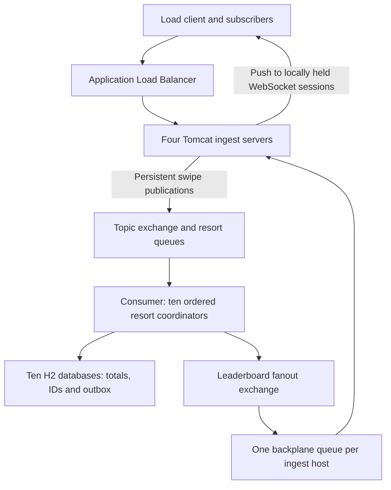

# SkiTrak - Distributed Systems

**Author:** Preethi Gajawada
**Course:** CS6650 - Distributed Systems
**Repository:** https://github.com/gajawp/SkiTrak

SkiTrak accepts skier lift-ride events, publishes them to RabbitMQ, aggregates vertical totals in a separate consumer service, and delivers real top-ten leaderboard updates over WebSocket connections.

Assignment 2 adds asynchronous processing and a leaderboard backplane to the earlier servlet/client project. The current deployment uses four ingest servers behind an AWS Application Load Balancer, one RabbitMQ host and one consumer host.

**Measured status:** the latest monitored run accounted for all 500,000 events with zero HTTP failures or retries, and all ten final leaderboards passed verification. Heavy-load queue-depth and consumer-lag targets were **not met**. The system is a lab deployment with single broker and consumer hosts, not a highly available production service.

## Repository layout

| Path | Purpose |
| --- | --- |
| `server-v2/` | Assignment 2 servlet, confirmed queue publishing and WebSocket integration |
| `consumer/` | Ordered per-resort consumers, durable aggregation, deduplication, outbox and diagnostics |
| `client-part2/` | Current load client, HTTP measurements, CSV export, snapshot verifier and latency probe |
| `deployment/` | RabbitMQ Compose definition and environment example |
| `monitoring/` | RabbitMQ monitoring script and monitoring notes |
| `results/` | Saved run logs, verification JSON, monitoring data and reports |
| `server/`, `client-part1/` | Earlier assignment components |
| `AI_USAGE.md` | AI assistance, accepted suggestions, corrections and validation |
| `DEPLOYMENT_MONITORING.md` | Existing AWS deployment settings and reproduction runbook |

The active detailed client is `client-part2/`. Local backup directories and old client copies are not the paths used by the commands below.

## Reports

- [Two-page architecture document](results/SkiTrak_Assignment2_Architecture.pdf)
- [Measured results and limitations](results/SkiTrak_Assignment2_Results.pdf)
- [Deployment and monitoring runbook](DEPLOYMENT_MONITORING.md)
- [AI usage reflection](AI_USAGE.md)
- [Consumer notes](consumer/README.md)
- [Consumer scaling notes](consumer/SCALING.md)
- [WebSocket setup](server-v2/WEBSOCKET_SETUP.md)
- [Monitoring notes](monitoring/README.md)

## Architecture



### Swipe acceptance and routing

The servlet validates URL fields and the JSON body, looks up lift vertical, and attaches a UUID event ID, ingest timestamp and server identity. It publishes a persistent message to durable topic exchange `skitrak.exchange`, using routing key `resort.N`. Durable queues `resort.1` through `resort.10` separate resort workloads.

Each ingest process reuses a publishing connection with bounded channels and sender ownership. An HTTP request waits for its own publish confirmation. `201 Created` means publication was confirmed; it does not mean the consumer or WebSocket subscriber has finished processing the event.

When publication is unconfirmed, the request can return `503`. Retrying an uncertain request must reuse the **same event UUID**. Generating another UUID for the same logical retry defeats deduplication.

The queue topology includes configurable TTL and maximum length, reject-publish overflow and dead-letter routing to `skitrak.dead`. Finite retention and capacity still impose limits; persistence is not a guarantee against arbitrary overload or disk loss.

### Consumer ordering and durability

Each resort has an exclusive input consumer, one coordinator and one H2 database. A coordinator collects a bounded batch and submits one task at a time to a shared FIFO processing executor. It waits for the task to finish before reusing its channels, preserving per-resort queue delivery order.

Processed event IDs and fingerprints, vertical totals, changed snapshots and outbox entries commit atomically. Identical event IDs and swipe fields are deduplicated; the same ID with different fields is rejected. Top-ten ranking sorts by total vertical descending and numeric skier ID ascending for ties.

Input deliveries are manually acknowledged after the durable transaction and confirmed outbox publication. Failure between publication and recording its completion can cause replay. The design provides idempotent aggregation with at-least-once delivery, not exactly-once transport.

### WebSocket connection locality

A WebSocket session belongs to the ingest server that accepted it. The consumer publishes snapshots to `leaderboard.fanout`; each ingest identity receives them through its own `leaderboard.ws.ingest-N` queue and pushes to its local subscribers. This lets swipes accepted on one ingest host update subscribers attached to another.

Sticky sessions do not replace this backplane. A failed WebSocket host requires client reconnection. Snapshot versions change when the top list changes, so one accepted swipe does not necessarily produce one leaderboard update.

## Prerequisites and builds

- Java and Maven; the consumer targets Java 11 bytecode/API compatibility.
- Tomcat 9 for the servlet's `javax.servlet` and `javax.websocket` APIs.
- RabbitMQ; the recorded deployment used `rabbitmq:4.1-management`.
- Python with `websockets` for verification; the recorded Mac environment used `websockets` 16.0.
- SSH access to the lab hosts for deployment checks and diagnostics.

From the repository root:

```bash
mvn -f server-v2/pom.xml clean package
mvn -f consumer/pom.xml clean package
mvn -f client-part2/pom.xml compile
```

The consumer produces `consumer/target/consumer-1.0-SNAPSHOT.jar`. The recorded metrics build passed **22 consumer tests** with zero failures or errors. Build outputs under `target/` and `output/` are generated files, not submission source.

For the Python tools, from `client-part2`:

```bash
python3 -m venv .venv-verify
.venv-verify/bin/python -m pip install 'websockets==16.0'
```

## API paths

In the lab, the WAR context is `/ski-servlet`.

| Interface | Path |
| --- | --- |
| Ingest health | `GET /ski-servlet/health` |
| Submit lift ride | `POST /ski-servlet/skiers/{resort}/seasons/{season}/days/{day}/skiers/{skier}` |
| WebSocket leaderboard | `/ski-servlet/leaderboard/{resort}?dayID={day}` |
| Consumer health | `GET /health` on its diagnostic HTTP port |
| Consumer statistics | `GET /stats` |
| Consumer snapshot | `GET /leaderboard/{resort}/{day}` |

Example against the recorded ALB:

```bash
curl -sS --max-time 15 -i \
  -H 'Content-Type: application/json' \
  -H "X-Event-ID: $(uuidgen)" \
  -d '{"time":1,"liftID":1}' \
  'http://skitrak-alb-1256428710.us-west-2.elb.amazonaws.com/ski-servlet/skiers/2/seasons/2026/days/1/skiers/85585'
```

`X-Event-ID` must be a plain UUID. The example creates a new event; it is not a retry. Successful responses include `X-Event-ID` and `X-Server-ID`. Body constraints include `time` 1-360 and `liftID` 1-40; the consumer deployment handles resorts 1-10.

## AWS deployment and configuration

The measured deployment used four t3.micro ingest hosts, a t3.small consumer host and a t3.small broker host. Public IPs are session-specific; confirm them in EC2 before using the runbook.

| ALB setting | Measured configuration |
| --- | --- |
| Target group | `skitrak-ingest-tg`, HTTP port 8080 |
| Health check | `/ski-servlet/health`, success code 200 |
| Interval / timeout | 30 / 5 seconds |
| Healthy / unhealthy threshold | 2 / 3 |
| Routing | Round robin |
| Cookie stickiness | Load-balancer generated, 300 seconds |
| Connection idle timeout | 300 seconds |
| HTTP client keepalive | 3,600 seconds |
| Deregistration delay | 300 seconds |

The consumer runs as systemd service `skitrak-consumer`, with `Restart=on-failure` and a five-second delay. RabbitMQ container `skitrak-rabbitmq` uses Docker restart policy `unless-stopped`. Tomcat was manually started after VM restart in the recorded experiments.

Set unique `SERVER_ID` values for ingest hosts. Supply broker host, port, user, password and vhost through environment configuration. Do not commit credentials, private keys, local environment files or H2 databases.

Current consumer experiment settings:

| Variable | Value |
| --- | --- |
| `CONSUMER_THREADS` | 2 |
| `CONSUMER_MIN_THREADS` | 2 |
| `CONSUMER_MAX_THREADS` | 10 |
| `CONSUMER_DYNAMIC_SCALING` | true |
| `CONSUMER_BATCH_SIZE` | 200 |
| `CONSUMER_BATCH_WAIT_MS` | 20 |
| `TOP_N` | 10 |

The shared executor cannot process more than ten resort tasks concurrently. Fixed capacities 20, 40 and 80 are configuration experiments, not evidence of 80 active aggregation workers. Pool `queuedBatches=0` does not establish that RabbitMQ queues are empty.

See [the runbook](DEPLOYMENT_MONITORING.md) for addresses, SSH forwarding, health checks and monitoring commands. `deployment/compose.yaml` and `deployment/env.example` describe the broker setup; inspect and configure the example before starting a fresh environment.

## Run the load client

Keep the consumer diagnostic tunnel open as described in the runbook. From `client-part2`:

```bash
java -Dskitrak.totalSwipes=500000 \
  -Dskitrak.warmupSwipes=32000 \
  -Dskitrak.drainTimeoutSeconds=600 \
  -cp target/classes LoadClient \
  'http://skitrak-alb-1256428710.us-west-2.elb.amazonaws.com/ski-servlet' \
  512 10 2026 1 \
  2>&1 | tee "../results/assignment2-500k-$(date +%Y%m%d-%H%M%S).log"
```

The positional arguments after the base URL are main threads, resorts/subscribers, season and day. The recorded run used 32 warmup threads. Inspect the client output for `RUN COMPLETE` and expected consumer-count accounting; successful `tee` output alone does not establish client success.

Each run exports `swipes.csv` and `throughput.csv` to a directory named `results/part2-<threads>threads-<timestamp>/`. The client reports HTTP attempt latency separately from ingest throughput and throughput including setup/consumer drain. Initial WebSocket handshake time is not live update latency.

## Verify current leaderboards

With the tunnel serving `127.0.0.1:19090`, from `client-part2`:

```bash
.venv-verify/bin/python src/main/java/verify_leaderboards.py \
  --base 'http://skitrak-alb-1256428710.us-west-2.elb.amazonaws.com/ski-servlet' \
  --consumer 'http://127.0.0.1:19090'
```

The verifier compares resort, day, version, ranks, skier IDs and totals against consumer snapshots. A pass establishes current snapshot agreement, not delivery of every historical update.

## Measure isolated POST-to-WebSocket latency

Stop other producers before running:

```bash
.venv-verify/bin/python src/main/java/measure_websocket_latency.py \
  --base 'http://skitrak-alb-1256428710.us-west-2.elb.amazonaws.com/ski-servlet' \
  --consumer 'http://127.0.0.1:19090' \
  --resort 2 --samples 20
```

The probe sends real events one at a time and checks the exact next leaderboard version, selected skier's increased total and one unique-event count increment per sample. It measures Mac monotonic time from POST dispatch to matching WebSocket receipt. This includes scheduling, HTTP, queueing, aggregation and delivery; it is not WebSocket-only latency or a concurrent-load measurement.

Commit metrics on `/stats` have a different scope: ingest timestamp to successful database commit for fresh events, plus batch processing time. They are process-local and cumulative since restart. Historical persisted events are excluded. Cross-host lag needs synchronized clocks; batch processing time excludes queue/pool wait, ACK and outbox publication.

## Measured results

### Latest monitored 500k run

Four ingest hosts; 512 main client threads; dynamic consumer pool 2-10.

| Metric | Result |
| --- | ---: |
| Successful swipes / failures / retries | 500,000 / 0 / 0 |
| Main ingest throughput | 7,591.63 swipes/sec |
| Ingest duration | 76.389 sec |
| Additional consumer drain wait | 217.480 sec |
| Wall time including setup and drain | 294.214 sec |
| Throughput including setup and drain | 1,699.44 swipes/sec |
| HTTP mean / p95 / p99 | 63.002 / 130.511 / 214.992 ms |
| WebSocket updates / connections | 126 / 10 |
| WebSocket reconnections / invalid messages | 0 / 0 |
| Consumer unique count before / after | 9,310,076 / 9,810,076 |
| Final leaderboard verification | All ten resorts passed |

Evidence: `results/assignment2-system-metrics-500k-20261109-163712.log`, `results/part2-512threads-1794271327161/`, `results/system-metrics-20261110-003659/` and `results/leaderboard-verification-20261109-164800.json`.

### Earlier pool-capacity experiments

Each run used four ingest hosts, 512 main client threads and 500,000 swipes.

| Pool setting | Main ingest /sec | Additional drain sec | Overall /sec |
| --- | ---: | ---: | ---: |
| Fixed 10 | 7,990.39 | 183.644 | 1,929.68 |
| Fixed 20 | 7,973.63 | 216.669 | 1,726.03 |
| Fixed 40 | 7,897.18 | 221.095 | 1,696.14 |
| Fixed 80 | 8,097.56 | 264.783 | 1,479.41 |
| Dynamic 2-10 | 7,923.25 | 191.750 | 1,884.34 |

These are individual sequential runs. Database growth and host conditions limit causal comparisons. Increasing configured capacity beyond the ten-resort parallelism limit did not produce an observed completion-throughput improvement.

A separate four-ingest one-million-swipe run completed with zero HTTP failures, main throughput 7,118.89/sec and additional drain wait 328.133 sec. Historical configurations and workload details are discussed in the results report; they are not all matched experimental conditions.

### Latency and resource findings

- Twenty isolated POST-to-WebSocket probes passed: mean 51.20 ms, median 51.34 ms, nearest-rank p95 52.38 ms and maximum 52.54 ms. All twenty were below 100 ms under this isolated workload.
- A separate 100k concurrent-load run measured mean event-to-commit lag **22.425 seconds**, maximum **39.378 seconds**, with only **0.145%** of events below 100 ms.
- Final cumulative metrics cover **600,020** fresh events across the 100k run, twenty probes and latest 500k run. Do not present them as the 500k experiment alone.
- During the estimated ingest window, host CPU execution averaged 23.7-26.9% across ingest servers and 88.5% on RabbitMQ. Consumer CPU execution averaged 63.6%, with 33.7% I/O wait.
- During drain, consumer CPU execution averaged 54.1% and I/O wait 44.5%, supporting a consumer/storage bottleneck. Host-level `sar` alone does not identify the responsible database operation or device.
- Consumer peak `sar` memory used was 70.21%; minimum available memory was approximately 394 MiB. These are host metrics, not Java heap measurements.
- Each uploaded host log contains 202 two-second samples through 00:43:44 UTC, fewer than the requested 300. Phase boundaries in the report are estimates based on recorded client duration and result timestamp.

## Recovery validation

| Test | Observed outcome |
| --- | --- |
| Distribution without cookie reuse | Forty requests reached all four ingest IDs |
| Cookie stickiness | Ten cookie-preserving requests stayed on ingest-2 |
| Ingest shutdown | Immediate request returned 502; after target became unhealthy, a request succeeded on ingest-3 |
| WebSocket host failure | Observed subscribers reconnected and a new swipe produced a subsequent live update |
| Persistent deduplication | Same UUID counted once before and after consumer restart |
| Consumer SIGKILL under load | Client completion polling failed during the outage; later counts accounted for all 100k swipes and leaderboards passed |
| Broker graceful stop/start | Ingest health became 503 during outage, recovered afterward, and a new event was processed without manually restarting applications |

The broker experiment was not a pending-message crash-durability test. The in-flight crash evidence includes a near-crash sample of 2,000 unacknowledged messages, but does not establish an exact redelivery count. Preserve failed and reconciled results separately rather than relabeling failed client checks as clean runs.

## Monitoring and evidence handling

`monitoring/monitor_rabbitmq.py` records queue depth and rates; the runbook describes execution with password prompting. Capture host CPU, memory and interface rates before load begins and continue through consumer drain. Exclude Docker bridge/veth traffic when reporting physical-interface totals to avoid double counting.

Keep raw logs and verification reports with the plots. Distinguish resort queues, intentionally retained `leaderboard.audit` snapshots and the dead-letter queue. Resource measurements from a later run cannot be assigned to earlier runs retrospectively.

## Known limits

- Queue depth exceeded 1,000 messages under heavy load, and consumer lag exceeded 100 ms. These targets remain unmet despite eventual count reconciliation.
- One broker host and one consumer host are failure domains; local H2 databases do not provide cross-host durability or failover.
- Health-check detection is not instantaneous. Sticky cookies and reconnect logic do not guarantee uninterrupted delivery during failure.
- The snapshots key totals by resort/day/skier; season is present in the ingest URL but is not a separate aggregation key in the current consumer schema.
- The recorded deployment uses HTTP. It does not establish production authentication, TLS configuration or authorization.
- ALB request routing was demonstrated with response server IDs. That evidence is distinct from CloudWatch request-distribution metrics.

## Submission and repository hygiene

The submission includes the Git repository URL, a maximum-two-page architecture document, measured results, actual monitoring scripts and `AI_USAGE.md`. Consult the assignment specification for the complete submission requirements.

Keep generated artifacts and local state out of commits: virtual environments, build directories, private keys, populated environment files, H2 databases, packet captures, JFR captures, Tomcat copies and backup directories. Keep reproducible source, configuration examples and selected evidence. Review staged changes before committing; do not add the entire working tree without inspection.
